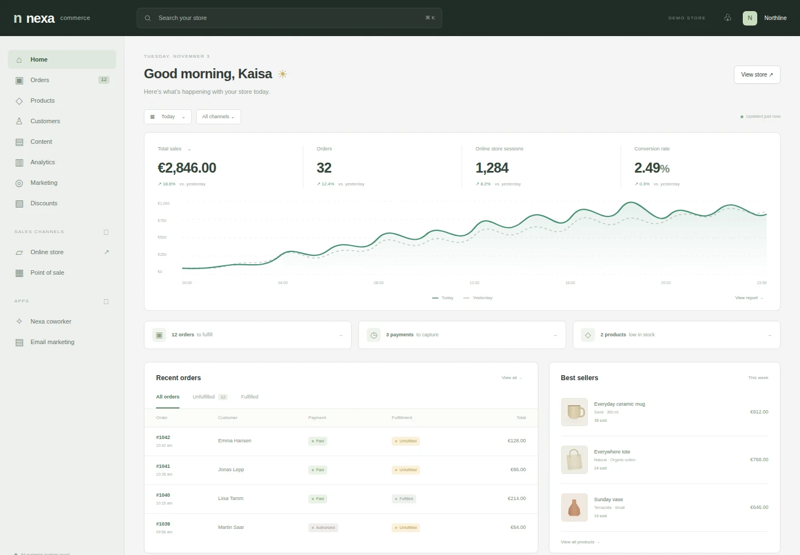

# Nexa Ecommerce

A Shopify-inspired store administration starter: sales overview, order statuses, fulfillment tasks, and best-selling products. Original Nexa interface; no Shopify assets, code, or services are included. Product illustrations are drawn with CSS.

[Live preview](https://nexa-ecommerce.nexa-templates.workers.dev/) · [Use with Nexa](https://admin.nexaintel.work)



This is a **visual template with fictional sample data**, not a working shop. Order search and filters work locally; other controls explain that they are previews. There is no storefront, checkout, payment processing, inventory service, persistence, authentication, or external asset dependency.

## Run and build

Use Node.js 22 or newer. No dependency installation is needed.

```sh
npm run dev          # http://localhost:3000; PORT overrides the port
npm run build        # static site in dist/
```

Edit `index.html`, `styles.css`, and `app.js`. Sample orders, products, metrics, and the SVG chart are in `index.html`. GitHub Pages serves the main branch from the repository root.

## Make it yours

Choose **Use template** in Nexa, or import `https://github.com/nexa-templates/ecommerce.git` as a new project. Preserve upstream Git history for updates. Set a unique Worker name in `wrangler.jsonc` and deploy using the project's Cloudflare connection. No account IDs, secrets, or bindings are included.

In Nexa **Build & deploy**, select the connected Worker and production branch, use `/` as the root, `npm ci` to install, `npm run build` to build, and `npx --no-install wrangler deploy --name "$NEXA_WORKER_NAME"` to deploy. Enable automatic deployments. Run the initial build, follow its exact commit to success, and verify the saved deployment and Visit URL. Later production-branch pushes use this same pipeline. The public preview needs project sign-in disabled; it contains fictional data only.

Build the product catalog, inventory, customer accounts, order lifecycle, storefront, checkout, payment-provider integration, shipping, and tax rules as needed. Use a payment provider's hosted checkout for real transactions. There are no database migrations or integrations yet.

## Releases

- **0.1.0** — Responsive store dashboard, local order search and filters, static build, and Cloudflare assets configuration.

MIT licensed. See `LICENSE`.
